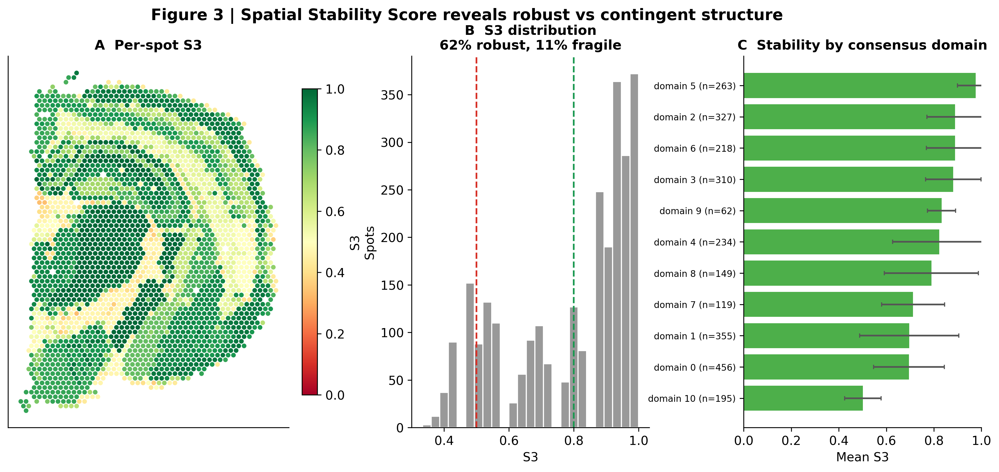

# MOSAIC: The Garden of Forking Tissues

[](https://github.com/ImSpxrsh/Spatial-Transcriptomics/actions/workflows/ci.yml)


**Multiverse Of Spatial Analysis: Instability & Concordance**

A specification-curve analysis framework for spatial transcriptomics. MOSAIC sweeps
across a curated set of defensible analytical pipelines and quantifies how much
biological conclusions — spatial domains, spatially variable genes (SVGs), and
cell–cell communication — depend on those analytical choices. The headline output is
the **Spatial Stability Score (S³)**, which separates robust findings from contingent
ones.

## Quick Start

```bash
# 1. Create an environment and install dependencies
python -m venv .venv && source .venv/bin/activate
pip install -r requirements.txt

# 2. Smoke-test the data loader (auto-downloads the Visium demo, ~300 MB)
python -m src.data_loader

# 3. Run a single pipeline spec
python -m src.pipeline

# 4. Verify determinism (same seed -> identical clusters)
python scripts/test_reproducibility.py

# 5. Run the full multiverse sweep (minutes to a few hours depending on spec count)
python scripts/main.py

# 6. Generate publication figures from the sweep outputs
python scripts/generate_figures.py
```

Run tests with `pytest`. Tests that touch the network (data loading) are marked
`@pytest.mark.network` and can be skipped with `pytest -m "not network"`.

## Project Structure

```
src/            Core library
  data_loader.py    Load + validate the Visium dataset
  pipeline.py       Parametric analysis pipeline (one spec -> results)
  stability.py      S³ + ARI (Hungarian label alignment) across the multiverse
  statistics.py     Permutation test, variance decomposition, bootstrap, confound,
                    convergence (+ their figures)
  downstream.py     Downstream-ML impact: region classification across pipelines
  tissue_imaging.py Real H&E histology, boundary insets, marker-gene maps
  visualization.py  Montage, spec-curve matrix, stability maps, extended data
  utils.py          Config/logging/IO helpers
scripts/        Executable entry points
  main.py                 Orchestrate the sweep (--dataset for other tissues)
  aggregate.py            Recompute aggregates from saved runs
  report_numbers.py       Populate paper macros from results
  generate_figures.py     Core figures
  generate_tissue.py      Histology figures
  generate_cross_dataset.py  Cross-dataset generalization (ED8)
  test_reproducibility.py Determinism check
configs/        multiverse_spec.yaml — 30-spec specification space
data/           datasets_manifest.md + caches
paper/          bioRxiv-style manuscript (main.tex, sections.tex) -> make paper
results/        runs / aggregate / figures / logs  (large runs gitignored)
tests/          Unit tests (27 offline)
```

## The Spatial Stability Score (S³)

- **Per-spot S³** — fraction of specs that assign a spot to its consensus domain.
  Because cluster *labels* are arbitrary across specs, labels are aligned to a
  reference spec by best-overlap matching (Hungarian assignment) before comparison.
- **Per-feature S³** — fraction of specs in which a gene is called a significant SVG
  (FDR < 0.05).
- **Headline instability** — spread (mean, std, range) of a summary metric such as the
  number of clusters across the multiverse.

See `src/stability.py` for exact definitions and the label-alignment caveat.

## Results

Sweeping 30 defensible pipelines over the 10x Visium mouse-brain coronal section
(2,688 spots, 18,078 genes):

| Metric | Value |
| --- | --- |
| Recovered spatial domains | 8–23 (mean 13.7 ± 4.0) |
| Mean pairwise Adjusted Rand Index between pipelines | 0.68 (0.46–0.90) |
| Spots with robust domain (S³ ≥ 0.8) | 62% |
| Spots fragile (S³ < 0.5) | 11% |
| Genes robustly spatially variable (S³ > 0.8) | 25% |
| Agreement with reference anatomy (ARI) | 0.66 (up to 0.77) |

**Stability tracks biology, not analysis.** Validated against the dataset's reference
anatomical annotation, robust regions coincide with well-defined structures (thalamus,
hippocampus, cortical layers) while fragile regions fall at boundaries and the lateral
ventricle. Additional analyses:

- **Variance decomposition:** clustering **resolution explains 80%** of the domain-count
  variance — standardize it first.
- **Confound check:** per-spot S³ vs sequencing depth Pearson **r = −0.09** — not a
  low-quality-spot artifact.
- **Permutation test:** 6/15 anatomical regions stable beyond chance (p < 0.05).
- **Downstream ML:** region-classification accuracy swings **5 percentage points**
  (0.89→0.94) from pipeline choice alone.
- **Generalization:** an independent second mouse-brain section (fluorescence Visium)
  reproduces the pattern (mean S³ 0.81, pairwise ARI 0.67).

The full manuscript (bioRxiv format, ~13 pages, 15 figures) is in [`paper/`](paper/)
with formal complexity analysis, a systems-architecture diagram, and the S³ math.


*Five defensible pipelines yield 8–18 domains from the same tissue; panel F is the
per-spot S³ overlay.*



The full figure set (main + extended data + an interactive Plotly explorer) is in
`results/figures/`. The NeurIPS manuscript is in `paper/` (build with `make paper`).

## Reproducibility

Every stochastic step is seeded with `random_state=42`. Each spec starts from raw
counts (`adata.layers["counts"]`) and normalizes independently — no information leaks
from global statistics computed before the sweep.

## Reproducing the study

```bash
make install            # venv + dependencies
make repro              # download data -> sweep -> figures (primary dataset)
python scripts/main.py --dataset visium_fluo   # second dataset (generalization)
python scripts/generate_cross_dataset.py       # Extended Data 8
make paper              # build the NeurIPS PDF (needs LaTeX / tectonic)
```

## Citation

```bibtex
@misc{roy2026mosaic,
  title  = {The Garden of Forking Tissues: Specification-Curve Analysis Reveals
            the Fragility of Biological Conclusions in Spatial Transcriptomics},
  author = {Roy, Sparsh},
  year   = {2026},
  note   = {https://github.com/ImSpxrsh/Spatial-Transcriptomics}
}
```

## Contributing

Branch off `main`, commit with simple present-tense messages (`add data loader`,
`fix svg key`), and open a PR. CI runs the offline test suite (Python 3.11/3.12)
and `ruff` on every PR.
