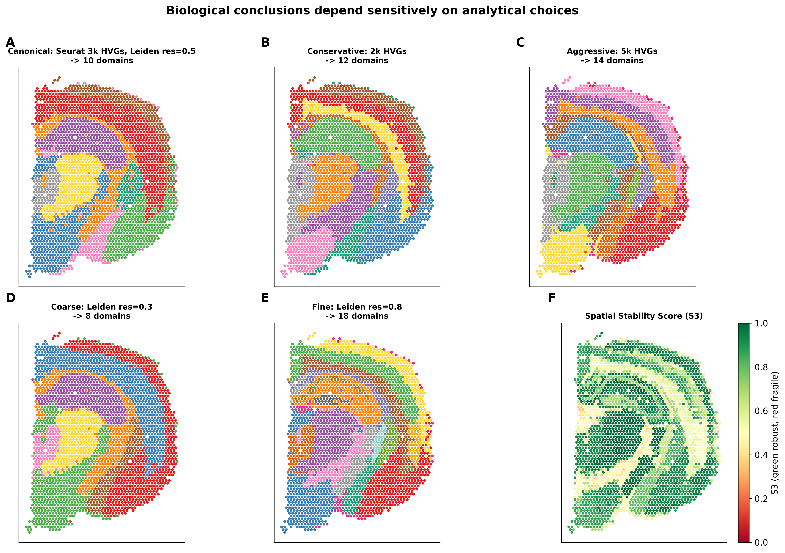

# MOSAIC: The Garden of Forking Tissues

**Multiverse Of Spatial Analysis: Instability & Concordance**

A specification-curve analysis framework for spatial transcriptomics. MOSAIC sweeps
across a curated set of defensible analytical pipelines and quantifies how much
biological conclusions — spatial domains, spatially variable genes (SVGs), and
cell–cell communication — depend on those analytical choices. The headline output is
the **Spatial Stability Score (S³)**, which separates robust findings from contingent
ones.

## Quick Start

```bash
# 1. Create an environment and install dependencies
python -m venv .venv && source .venv/bin/activate
pip install -r requirements.txt

# 2. Smoke-test the data loader (auto-downloads the Visium demo, ~300 MB)
python -m src.data_loader

# 3. Run a single pipeline spec
python -m src.pipeline

# 4. Verify determinism (same seed -> identical clusters)
python scripts/test_reproducibility.py

# 5. Run the full multiverse sweep (minutes to a few hours depending on spec count)
python scripts/main.py

# 6. Generate publication figures from the sweep outputs
python scripts/generate_figures.py
```

Run tests with `pytest`. Tests that touch the network (data loading) are marked
`@pytest.mark.network` and can be skipped with `pytest -m "not network"`.

## Project Structure

```
src/            Core library
  data_loader.py    Load + validate the Visium dataset
  pipeline.py       Parametric analysis pipeline (one spec -> results)
  stability.py      S³ computation across the multiverse
  visualization.py  Spec curves, stability maps, instability plots
  utils.py          Config/logging/IO helpers
scripts/        Executable entry points
  main.py                 Orchestrate the full sweep
  test_reproducibility.py Determinism check
  generate_figures.py     Final figures
configs/        multiverse_spec.yaml — the specification space
data/           raw / processed / reference
results/        runs / aggregate / figures / logs  (generated, gitignored)
tests/          Unit tests
```

## The Spatial Stability Score (S³)

- **Per-spot S³** — fraction of specs that assign a spot to its consensus domain.
  Because cluster *labels* are arbitrary across specs, labels are aligned to a
  reference spec by best-overlap matching (Hungarian assignment) before comparison.
- **Per-feature S³** — fraction of specs in which a gene is called a significant SVG
  (FDR < 0.05).
- **Headline instability** — spread (mean, std, range) of a summary metric such as the
  number of clusters across the multiverse.

See `src/stability.py` for exact definitions and the label-alignment caveat.

## Results

Sweeping 16 defensible pipelines over the 10x Visium mouse-brain coronal section
(2,688 spots, 18,078 genes):

| Metric | Value |
| --- | --- |
| Recovered spatial domains | 8–22 (mean 13.2 ± 3.9) |
| Mean pairwise Adjusted Rand Index between pipelines | 0.68 (0.49–0.90) |
| Spots with robust domain (S³ ≥ 0.8) | 57% |
| Spots fragile (S³ < 0.5) | 4% |
| Genes robustly spatially variable (S³ > 0.8) | 28% |
| Agreement with reference anatomy (ARI) | 0.65 (up to 0.76) |

**Stability tracks biology, not analysis.** Validated against the dataset's reference
anatomical annotation, robust regions coincide with well-defined structures (thalamus
S³ ≈ 0.98, hippocampus) and fragile regions with boundaries and the lateral ventricle
(S³ ≈ 0.48).



*Five defensible pipelines yield 8–18 domains from the same tissue; panel F is the
per-spot S³ overlay.*


The full figure set (main + extended data + an interactive Plotly explorer) is in
`results/figures/`. The NeurIPS manuscript is in `paper/` (build with `make paper`).

## Reproducibility

Every stochastic step is seeded with `random_state=42`. Each spec starts from raw
counts (`adata.layers["counts"]`) and normalizes independently — no information leaks
from global statistics computed before the sweep.

## Contributing

Branch off `main`, commit with simple present-tense messages (`add data loader`,
`fix svg key`), and open a PR. CI runs the offline test suite (Python 3.11/3.12)
and `ruff` on every PR.
